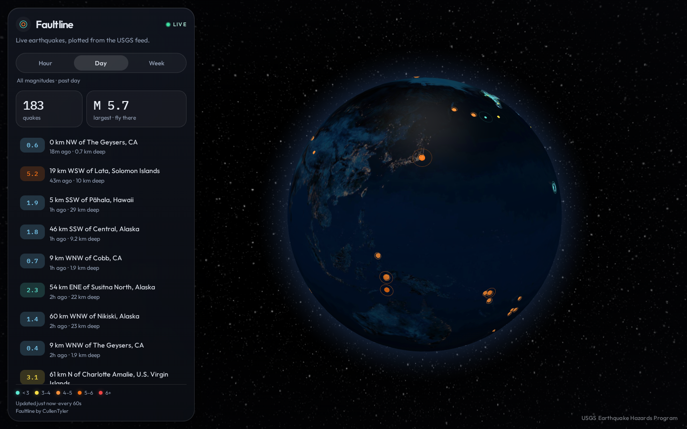

# Faultline

Faultline is a live earthquake globe. It draws the last hour, day, or week of earthquakes on a dark 3D earth. Markers are sized and colored by magnitude, they pulse, and clicking one flies the camera there.

Data is the live public [USGS GeoJSON feed](https://earthquake.usgs.gov/earthquakes/feed/v1.0/geojson.php). No API key.

Built by CullenTyler.



## Tech stack

React, TypeScript, Vite, react-globe.gl / three.js, Vitest, Playwright, and ESLint.

## Run

```bash
npm install
npm run dev
npm test
npm run build
```

`npm run dev` serves the app at [http://127.0.0.1:4731](http://127.0.0.1:4731).

`npm test` runs the Vitest unit tests (feed parsing and magnitude styling). The Playwright smoke test, which stubs the USGS feed, is:

```bash
npm run test:e2e
```

`npm run build` typechecks and writes a static site to `dist/`. Preview it with `npm run preview`.

No API key and no backend. The page fetches the public USGS GeoJSON feeds directly.

## How to record a 30-second demo

1. Open the app on **Day** and let the globe rotate for two seconds so the pulses are obvious.
2. Point at the quake count and the largest magnitude.
3. Click **largest · fly there**. Wait for the camera to arrive. The card shows magnitude, depth, place, your local time, and a USGS link.
4. Click **Week**. Magnitude 2.5+ events fill in along the ring of fire.
5. Click **Hour**. The map drops to whatever happened in the last hour.
6. Click empty ocean to clear the selection, and let the globe rotate out.

## Deploy

This is a static site. Run `npm run build` and publish the `dist/` folder.

- **Netlify / Cloudflare Pages:** build command `npm run build`, publish directory `dist`. No environment variables.
- **GitHub Pages:** same build. For a project site, set `base` in `vite.config.ts` to `/your-repo-name/` before building.
- **Any static host or S3 bucket:** upload `dist/`.

The browser calls `earthquake.usgs.gov` on its own. Those feeds send `Access-Control-Allow-Origin: *`, so a static host is enough.

## What the screen is doing

- **Hour** is `all_hour`, **Day** is `all_day`, **Week** is `2.5_week` (magnitude 2.5 and above). The caption under the toggle says which.
- Color runs from blue (micro) through teal, yellow, and orange to red (magnitude 6+). Bigger quakes are larger and pulse faster.
- The list is newest first. The biggest quake is called out separately.
- The camera auto-rotates until you drag or select a quake. After a selection is cleared, or after you stop dragging, rotation resumes.
- The feed refreshes every 60 seconds. Quakes that were not in the previous response highlight in the list and pulse faster for a few seconds.
- If the first fetch fails, the panel shows the error and a retry button. If a later refresh fails, the last good set stays on the globe.
- An empty window (often the past hour) says so, and the globe stays up.

## Tests

- `src/lib/usgs.test.ts` parses the GeoJSON feed: earthquakes only, bad features skipped, a broken payload throws, largest-quake tie break.
- `src/lib/magnitude.test.ts` maps magnitude to color, size, altitude, and pulse speed, including missing and non-finite values.
- `e2e/smoke.spec.ts` loads a mocked feed, checks the count, opens details (depth, local time, USGS link), and switches hour and week.

## Limitations

- The week feed starts at magnitude 2.5. Hour and day include every magnitude USGS publishes in those windows.
- Above 400 earthquakes, pulse rings stay on the largest events, plus the one you selected and any that just arrived. Every quake is still drawn as a dot.
- Times use your time zone. USGS no longer provides the time zone at the epicenter.
- The globe needs WebGL. If it cannot start, the list still loads.
- A new quake announces itself with a faster pulse and a list highlight, not a separate explosion animation.
- The past hour is often almost empty. That is a quiet stretch, not a failed fetch.
